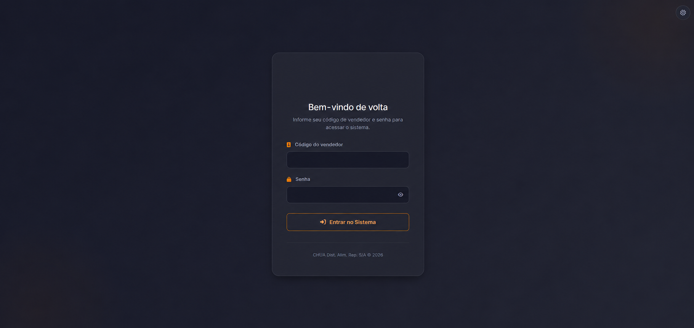
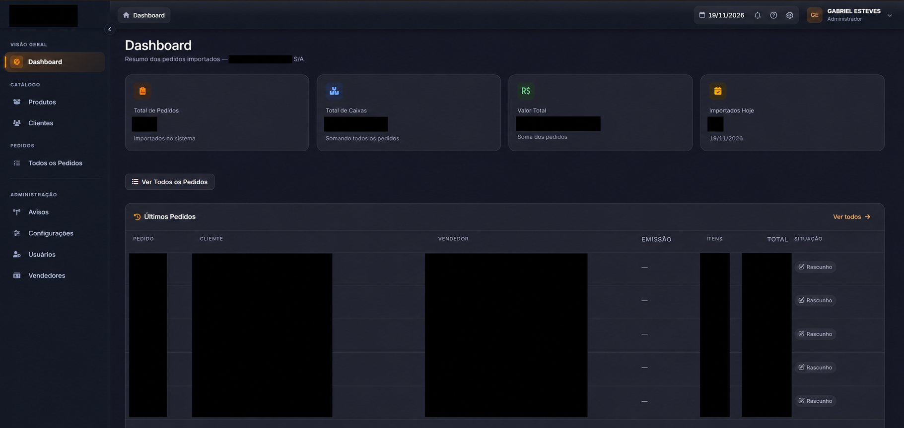
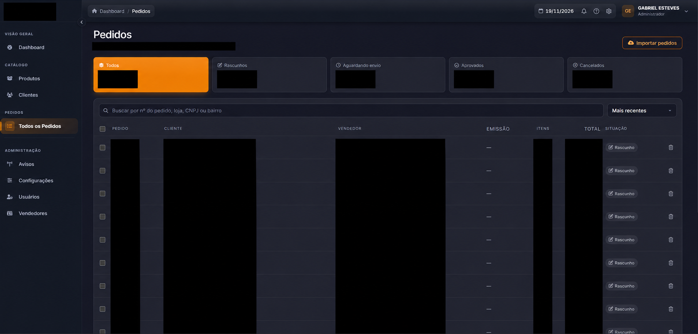

## Sistema de pedidos integrado ao TOTVS Protheus

Desenvolvi um sistema de pedidos que consulta informações de clientes, produtos e pedidos em tempo real no ERP TOTVS Protheus. Os pedidos cadastrados na aplicação são enviados ao ERP para processamento. O sistema também permite acompanhar indicadores de vendas e consultar a situação dos pedidos.

### Tela de login

Acesso ao sistema com código de vendedor e senha.

### Painel de acompanhamento

Visão geral dos pedidos e dos indicadores de vendas.

### Consulta de pedidos

Tela para buscar pedidos e acompanhar sua situação.

